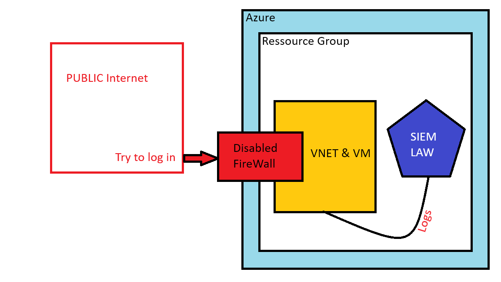
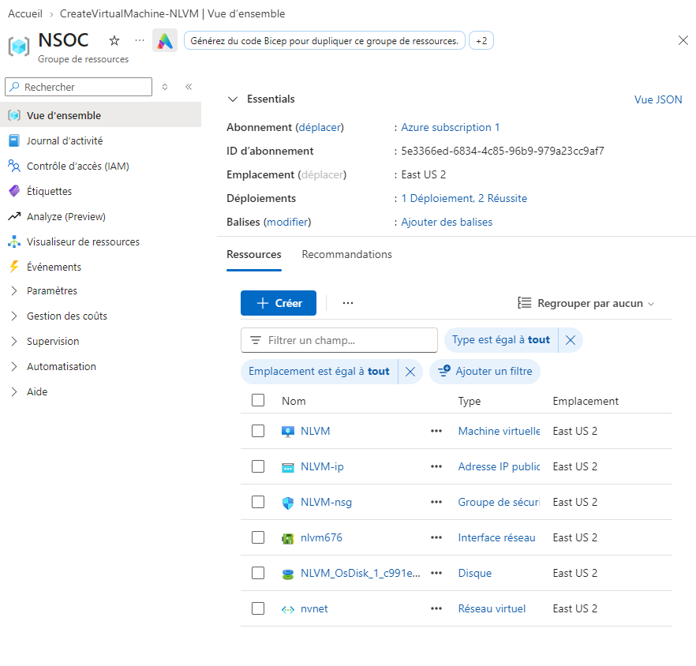
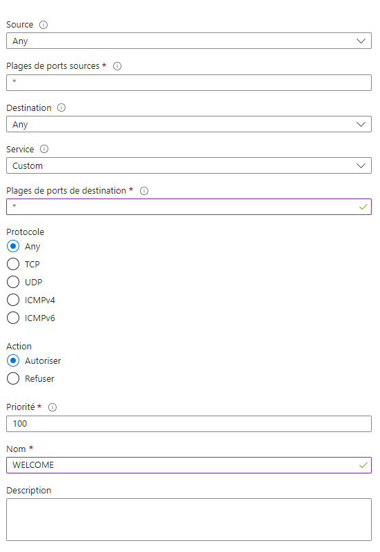
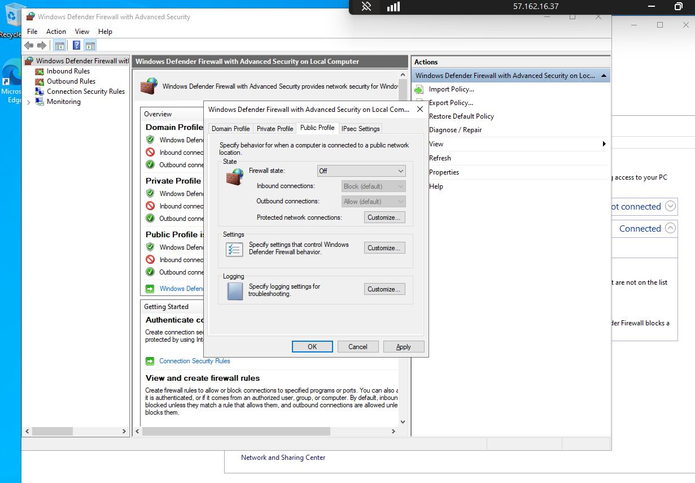
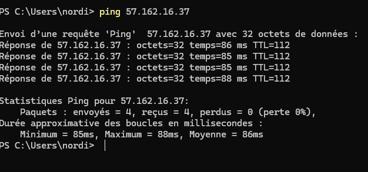
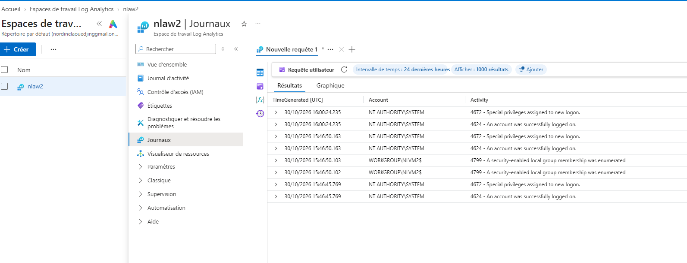

Project Overview : 

1) The Azure Subscription
2) Create a Ressource Group NSOC
3) Create a Virtual Network in NSOC
4) Create a Virtual Machine (the Honey Pot)

NLVM is the Virtual Machine
NLVM is the IP address which was created along the VM
NVLM-nsg is a Network security group which works like a cloud firewall
nlvm676 is ta Network Interface which work like an ethernet port

5) It's time to open our Network Security Group so anyone can access our Honey Pot
Let's create an inbound rule to allow anyone to connect to our machine 

6) Now we go on our VM and we disable the internal firewall. To do that we will need a remote access to our NVM. We use just enter the IP adress and the logs in the windows remote desktop tool.

A quick ping to make sure that our honey pot is visible on the Internet

7) Create a log analytics Workspace.
8) Create our Sentinel Instance SIEM

To connect our Log Analytic Workspace to our VM we need to install Windows Security Events extension which allow us to see the SecurityEvents logs from our VM

Now we can look for failed attempts to log on our VM. with this querry : 

SecurityEvent
| where EventID == 4625
| project TimeGenerated, Account, Activity, Computer, IpAddress

